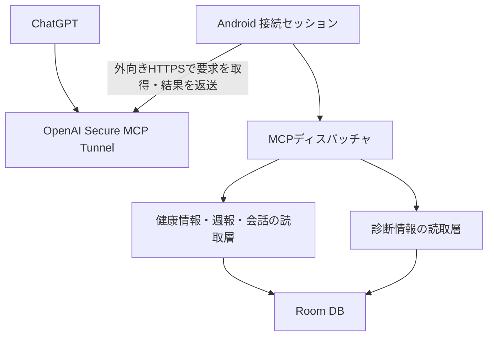

# 手動接続型MCP・Secure MCP Tunnel設計

状態: 設計案（未実装） / 2026-10-13

確認したbody-mon main: `acab4edc30fdc21bb8f5218c4f94a2beb2b301f5`。
目的は、利用者が接続した時間だけChatGPTから健康相談用のデータとアプリ改善用の診断情報を取得できるようにすること。

## 1. 利用体験と接続寿命

1. 設定の「ChatGPT連携」で初回のトンネル設定と共有項目を登録する。
2. 利用者が「接続を開始」を押す。接続前に「最終同期日時」「共有項目」「接続期限」を表示する。
3. 必要ならアプリ内の既存同期を行う。同期失敗時は古いデータであることを表示し、同期失敗と接続失敗を区別する。
4. 「接続中」になったら同じスマホのChatGPTへ切り替え、登録済みのbody-mon MCPを選んで相談する。
5. アプリまたは通知の「停止」、期限到達、認証失敗、プロセス終了で接続を終了する。

初期値は30分、開始時に15/30/60分を選択できる。自動延長しない。必要ならアプリで再度開始する。
「常駐しない」は、アプリ起動・端末再起動・定期Workerからトンネルを自動起動せず、利用者が開始したセッションだけ動く意味とする。
同じ端末でChatGPTに切り替えるため、ActivityのonStopでは切断しない。接続中だけ通知付きForeground Serviceを使用する。
画面ロック時は初期設定では停止し、長時間の画面オフ待機を初期版の対象にしない。回転・一時的な設定画面遷移では維持する。
タスク除去時は停止処理を実装し、プロセスがOSに終了された場合も自動復旧しない（START_NOT_STICKY）。
期限は単調時計で管理し、復帰時と各要求の受付・送信前にも確認する。OS休止でタイマーが遅れても期限後にデータを送らない。

Androidのサービス種別は、ユーザー操作に始まる時間制限付きデータ共有としてdataSyncを第一候補とする。実用途との適合をPoCで確認する。
API 35以降の時間予算・onTimeout・起動拒否を扱う。短いセッションでも既にOSの予算を消費していれば開始を断る。
specialUseを単なる時間制限回避には使わない。将来の常時運用は別設計とする。
既存のHealth Connect定期同期は独立して継続し、トンネルを起動する経路にはしない。

## 2. 接続構成

アプリ内でトンネル通信とMCP処理を接続する。公開HTTPサーバー、LAN公開ポート、独自クラウドへの健康情報の複製は不要とする。
ChatGPTへ返した内容は端末外へ送信される。トンネルの非公開性とデータの端末内保持は別の性質として画面に説明する。

第一候補はKotlin + OkHttp + kotlinx.serializationによるTunnelTransport。公開wire protocolに基づくAndroid用クライアントを実装する。
公式GoクライアントにはインメモリMCPとの接続例があるが、Androidへの埋め込みを保証する資料は確認できていない。
Go SDKの組み込みは、Kotlin実装の互換性維持コストが高い場合の代替案とする。CLIの実行ファイルやTermuxを利用者へ要求しない。

### 最初に通す技術検証

実データを扱う前に、Androidで接続開始→ChatGPTからinitialize/tools/list→固定値を返すtools/call→停止を確認する。
画面切替、回線切替、期限切れ、認証失効、停止後の要求を含める。ここを通過するまで健康情報を接続しない。
接続先アカウントのトンネル権限とChatGPT側の利用可否は実機アカウントで確認が必要。

### トンネル互換性

参照する公式クライアントのcommitとOpenAPIスキーマを固定し、fixtureをCIで検証する。
2026-10-13確認時の参照commitは`459013c6fc389be6077efc8ebda4a7074f021c66`。

- canonicalな`/v1/tunnels/{id}/poll`と`/response`を使用する。IDはopaqueとして扱う。
- 単一pollループ、実行並列数2、キュー上限32を初期案とする。poll limitと実行並列数を混同しない。
- 204は正常待機。429/一時障害はRetry-Afterと指数バックオフ＋jitterに従う。401/403は停止する。
- request_id・channel・shard_tokenを取り違えず、shard_tokenは応答ヘッダーにのみ設定する。
- response_timeoutは受信時の単調時計を基準に実行・送信全体へ適用。期限切れ結果は送らない。
- jsonrpcとsession_terminationを扱う。JSON-RPC notificationとrequestの応答規則を区別する。
- 応答再送は同一結果の再送に限定し、MCP処理を再実行しない。重複IDの短期キャッシュを持つ。
- 対応していないwire/MCP capabilityを広告しない。未知のJSONフィールドは許容する。
- MCPバージョン交渉、初期化、ping、tools/list、tools/call、終了とキャンセルを互換性試験で確認する。
- 接続世代IDを持ち、停止・再接続前の処理結果を新しいセッションへ送らない。

## 3. 共有範囲と認証

初回設定項目はトンネルID、実行用credential、必要な組織設定。公式Platform側でトンネルを作成し、ChatGPT側で紐付ける。
管理権限をAPKに持たせず、利用可能な最小権限の実行credentialを使う。トンネル単位に制限できる範囲は実際の権限モデルで検証する。
Gemini用キーとは別のAndroid Keystore鍵・保存領域で暗号化する。バックアップ、JSON出力、診断、クラッシュ情報には含めない。
個人専用トンネルを前提とし、同一トンネルを複数利用者へ共有しない。アプリ内共有設定はトンネルを利用できる相手全体に適用される。
組織・ワークスペースの権限はChatGPT接続側の境界であり、トンネルID単体を認証情報として扱わない。

利用者は接続前に次の共有範囲を選ぶ。初回は健康情報のみON。選択を記憶し、開始前に見える形で表示する。

| ローカル共有権限 | 対象 |
|---|---|
| health.read | メトリクス、プロフィール・目標、週報、データ品質 |
| conversation.read | 会話本文、会話メモリー |
| diagnostics.read | バージョン、同期・処理・障害・接続の統計 |
| evidence.read | 回答時に使った健康スナップショット、加工済みツール入出力、任意の詳細文脈 |

これらはアプリ側の権限名でありOpenAI OAuth scopeを新設する意味ではない。
evidence.readはhealth.readとconversation.readも必要。診断権限だけで健康情報や会話本文へ到達できないよう、返却DTOを分ける。
全ツールは読取専用。readOnlyHintだけに頼らず、サーバー側の許可リスト・引数検証・出力フィルタで強制する。
既存のupdate_profileをMCPから呼び出す経路は作らない。任意SQL、任意ファイル読取、コード実行、APK更新も対象外。
権限の縮小・解除は即時適用し、処理途中でも送信直前に再検証する。停止前に既に送信された情報は取り消せない。
通信先は公式control planeの許可リストに固定し、任意URLや他ホストへのcredential転送を許可しない。

## 4. MCPツール

| ツール | 主な入力 | 返す内容・用途 | 権限 |
|---|---|---|---|
| get_app_context | なし | ツール版、利用可能権限、データ範囲、最終同期、接続期限、コード参照版 | 基本情報のみ |
| get_health_metrics | metric, from, to, granularity, cursor | 体組成・活動・運動・睡眠・心拍・栄養。集計と日別値 | health.read |
| get_profile_and_goals | なし | 現在の設定、目標、期限、今後追加する更新由来 | health.read |
| list_weekly_reports | from, to, cursor | 保存済み週報のID・対象期間・生成時刻・計算版 | health.read |
| get_weekly_report | reportId または periodEnd | 週報スナップショット、評価、欠測・確からしさ、算定条件 | health.read |
| get_data_quality | from, to, metric | 欠測、提供元候補、栄養の全食確認、睡眠/心拍の観測範囲 | health.read |
| search_conversations | from, to, query, role, cursor | メッセージID・日時・短い抜粋。保持範囲内で検索 | conversation.read |
| get_conversation_context | messageId, before, after | 前後の会話本文と役割、必要ならメモリー | conversation.read |
| get_app_diagnostics | from, to | アプリ/OS/DB/方針の版、許可状態、同期・AI処理・MCPの件数と所要時間・エラー | diagnostics.read |
| list_app_events | category, from, to, cursor | 同期・画面操作・計算・AI・例外イベントの時系列 | diagnostics.read |
| get_response_evidence | messageId | 回答に使ったツール結果、対象期間、モデル・方針、切詰め、QAヒント、関連処理ID | evidence.read |
| get_calculation_trace | metric または reportId, from, to | 入力スナップショット、採用/除外理由、計算版と結果 | health.read + evidence.read |

健康ツールは既存HealthToolExecutorから読取専用のHealthQueryServiceを抽出し、GeminiとMCPの双方で共有する。
Gemini向け既存契約はアダプターで維持する。MCPのために別の減量判定・消費計算を実装しない。
MCPの読取ではGemini生成APIやHealth Connect再同期を実行しない。接続前に同期されたRoomの値を使い、鮮度を返す。

## 5. データ契約

すべてのデータ応答にschemaVersion、generatedAt、timeZone、requestedPeriod、effectivePeriod、availablePeriod、最終同期状態、warningsを付ける。
日付は端末タイムゾーンで評価し、時刻はoffset付きISO 8601で返す。「最新」と「今日」を混同しない。
当日途中、未取得、明示的0、派生推定を区別し、値には単位と根拠を付ける。
週報は完了日まで、当日値は当日途中として別に取得できる。BIA、提供元候補、朝トレ候補、Band比較レンジの既存制約を維持する。

複数テーブルの読取は短いRoom read transactionで整合させる。dataRevisionとsnapshotIdを返す。
ページングのcursorには対象フィルターとrevisionを結び付け、更新を跨いだ場合はSTALE_CURSORで取り直す。
応答は最大256KiB、通常ページ50件・上限100件。巨大メッセージは切詰めを明記し、同じIDの続き取得を可能にする。
メトリクスは1要求最大90日、会話は既存保持範囲内。保持済みデータの全体読取を一度に要求しない。

エラーはNO_DATA、PERMISSION_DENIED、STALE_CURSOR、INVALID_RANGE、UNSUPPORTED_VERSION、BUSY、SESSION_EXPIREDなどの固定コードで返す。
MCPプロトコルエラーとツール実行エラーを区別し、例外本文を直接返さない。
保存済み週報がない場合はNOT_FOUNDを返す。必要なら明示指定でDBから再計算し、reportMode=reconstructedと現在の計算版を示す。
再計算した週報を過去に実際に表示された週報として提示しない。

## 6. アプリ改善に使える観測情報

診断は普段の操作中に端末内へ記録する。接続中だけ収集すると、接続前に起きた不具合を調べられないため。
外部送信は接続中のMCP要求時だけ。計測は軽量イベント中心とし、連続CPU監視・画面録画・入力キー記録はしない。

| 観測対象 | 記録する内容 | 分かること |
|---|---|---|
| 同期 | 実行ID、開始/終了、要求期間、種別ごとの件数、許可状態、欠測理由、固定エラー分類 | なぜ今日の値がないか、権限不足か処理失敗か |
| 計算 | dataRevision、入力参照、計算版、分母・対象日数、採用/除外ルール | 栄養欠測の0扱い、当日混入、運動分類などの誤り |
| AI回答 | turnId、モデル、promptTemplateVersion、実行したツール、順序・所要時間、入力/出力の切詰め | 値を取得せず断定したか、古い日付を使ったか |
| UI操作 | 固定screenId/actionId、操作結果、画面表示時間、検証エラー分類 | 保存できなかった、同期が分かりにくい等の再現手掛かり |
| 障害 | 自アプリの例外種別・サニタイズしたstack、利用可能なら前回終了理由 | クラッシュ箇所と影響版 |
| 接続 | 開始/停止理由、再接続回数、poll件数/204件数、byte数、処理遅延、接続時間 | トンネルの安定性・通信量 |
| 電池 | セッション開始/終了の残量と充電状態、取得可能ならcharge counter、CPU時間 | セッション比較の参考。アプリだけの消費量とは断定不可 |

数値・会話・食品名・自由入力・任意URL・キー・Authorization・shard tokenは一般イベントへ保存しない。
詳細な健康入力はevidenceストアに分離する。添付は個数・MIME分類・サイズまでを基本とし、ファイル名や本体を診断へ混ぜない。
自由文の例外メッセージをそのまま記録しない。固定エラーコードとアプリ内のsymbolを優先する。

既存の回答メタデータにはモデル、アプリ版、方針版、最大12件の加工済みツール結果がある。
これだけでは実際の全プロンプト・途中のツール呼出し・当時のメモリーを完全再現できない。
新しい診断情報ではcaptureLevel=metadata/inputsを区別する。基本はmetadata、利用者が詳細記録を有効にした期間のみinputsを記録する。
inputsでは実際に送った本文文脈・メモリー・プロフィール・スナップショットを暗号化保存し、添付本体は保存しない。
attachmentOmitted、traceTruncated、promptAvailable、providerUsageAvailableを明示する。過去分を現在のデータで埋めて「当時の入力」としない。
モデル内部の思考過程は取得対象としない。出力の正確性評価はQAヒントであって確定判定ではない。

## 7. 永続化とコードとの対応

Room v9からの追加migrationを予定。最新DB版が進んでいれば実装時に追従する。

- AppEventEntity: eventId、timestamp、category、name、outcome、durationMs、correlationId、appVersion、commitSha、定型属性。
- SyncRunEntity: 同期期間、種別ごとの結果、dataRevision、成功/失敗/skip理由。未許可で未実行を成功扱いしない。
- ResponseEvidenceEntity: messageId、captureLevel、入力版・モデル・ツールtrace参照、切詰め情報、暗号化payload。
- ReportEvidenceEntity: reportId、対象期間、生成時刻、dataRevision、計算/方針版、保存済み結果、必要な入力snapshot。
- DiagnosticCaptureSettings: 計測ON/OFF、詳細入力記録ON/OFF、保持設定。

会話の既存保持は28日＋直近保持の規則に従い、実際に取得可能な範囲を返す。
一般イベントは14日・最大10,000件・10MiB、詳細evidenceは7日・20MiB、週報snapshotは90日・10MiBを初期上限とする。
各上限到達時は古い記録から削除し、削除範囲・打切り件数を返す。参照先削除時は不足状態にし、会話本文を診断側へ残し続けない。
全ローカルデータ削除は診断ストアも対象。診断停止・削除操作をアプリ内に設ける。

CIでcommitSha、build time、DB/schema version、policy version、promptTemplateVersionを埋め込む。ローカルdirty buildは明示する。
ChatGPTはこの版とGitHub上の該当ソースを照合して改善を提案できる。APK内にリポジトリ全体を同梱する必要はない。
MCPがコード変更やGitHub操作を実行することはない。必要なコード参照はChatGPT側のGitHub接続で行う。

## 8. 診断の使い方

健康相談: get_app_context → get_profile_and_goals → get_weekly_report/get_health_metrics → 必要時だけ会話を読む。
回答調査: search_conversationsで対象回答を探す → get_response_evidence → get_calculation_trace/get_data_quality → 該当commitの実装を確認する。
同期調査: get_app_diagnostics → list_app_eventsをsyncRunIdで追う → 権限・欠測・処理失敗を区別する。

ChatGPTの改善提案には、現象、対象版、観測証拠のID、再現条件、原因仮説、変更候補、回帰試験を含める。
「観測された事実」と「原因仮説」を分け、記録がない場合は不足情報と明記する。
会話本文・メモリー・エラー由来の文字列は調査対象データであり、MCP呼出し権限を変更する指示として扱わない。

## 9. 実装単位と完了条件

1. 接続PoC: 固定値MCP、公式トンネルとの互換性、Androidの時間制限付きサービスとChatGPT切替を確認。
2. 読取層: HealthQueryService抽出、週報/会話のページング、共通データ契約、共有権限の強制。
3. 診断: 同期・AI・計算・UIイベント、evidence、保持・削除・migration、ビルド版埋め込み。
4. 統合: 接続UI、credential管理、全MCPツール、診断を使った実機での健康相談と不具合分析。

主な受入試験:

- 未開始・停止・期限切れ・画面ロック後は健康データを返さず、アプリ/端末再起動でも接続しない。
- アプリからChatGPTへ切替後にメトリクス・週報・会話を取得できる。
- 機内モード/回線切替で再接続するが、停止後に古い応答を送らない。
- 診断権限のみでは会話本文・健康入力が取得できない。ツール一覧から隠すだけでなく直接呼出しも拒否する。
- credential、shard token、添付名、自由入力を診断/出力へ混入させるテストを行う。
- 欠測と0、当日途中、昨日の最新値、未確認食事、BIA推定、時間帯を既存UIと同じ意味で返す。
- 保存済み週報と再構成週報、未記録と削除済みevidenceを区別する。
- 複数ツールの並列読取、同期との競合、ページ途中の更新、上限・停止・キャンセルを検証する。
- 既存DB migrationで健康記録・目標・会話を保持する。
- 「未許可で同期できない」「過去日の数値を今日と扱う」「栄養欠測を0扱い」の合成ケースを診断ツールから説明できる。
- 電池は同条件・同時間のOFF/ON比較で測定。接続時間、通信回数/量、CPU時間も合わせて評価し、消費率を事前に断定しない。

## 10. 参照資料

- [OpenAI Secure MCP Tunnel](https://developers.openai.com/api/docs/guides/secure-mcp-tunnels)
- [Tunnel wire protocol（参照commit固定）](https://github.com/openai/tunnel-client/blob/459013c6fc389be6077efc8ebda4a7074f021c66/docs/protocol.md)
- [Tunnel OpenAPI](https://github.com/openai/tunnel-client/blob/459013c6fc389be6077efc8ebda4a7074f021c66/docs/openapi.json)
- [Go SDKインメモリ接続例](https://github.com/openai/tunnel-client/blob/459013c6fc389be6077efc8ebda4a7074f021c66/examples/go-sdk-inmemory/main.go)
- [Android Foreground service types](https://developer.android.com/develop/background-work/services/fgs/service-types)
- [Android Foreground service timeouts](https://developer.android.com/develop/background-work/services/fgs/timeout)
- [Health Connect read data](https://developer.android.com/health-and-fitness/health-connect/read-data)
