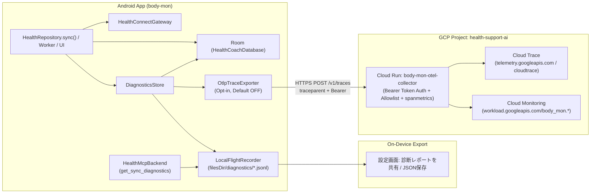

# Android Observability & GCP OpenTelemetry Architecture

本ドキュメントでは、`body-mon` における同期・永続化・MCP連携の可観測性（Observability）アーキテクチャ、段階別Span仕様、プライバシー境界、独立診断フライトレコーダ、および Google Cloud (`health-support-ai`) 上の OpenTelemetry Collector 構成と制約を説明します。

---

## 1. アーキテクチャ概要

### 設計原則
1. **ベストエフォート（フェイルセーフ）原則**:
   - `DiagnosticsStore`・`LocalFlightRecorder`・`OtlpTraceExporter` のいかなる例外・I/O失敗・ネットワーク切断・バッファ上限超過も、本体処理（Health Connect 同期・Room 保存・チャット・MCP 応答）を失敗させません（コルーチンの `CancellationException` のみ再スロー）。
2. **Room 非依存の診断証跡 (`LocalFlightRecorder`)**:
   - `filesDir/diagnostics/` 配下の循環 JSONL ファイルに直近の同期トレースとイベントを記録します。
   - Room マイグレーション失敗（`room.migration`）や SQLite 破損（`room.persist`）時でも、**「最後に成功した段階 (`lastSuccessfulStage`)」「失敗した段階 (`failedStage`)」「安全化済みエラー種別 (`errorKind`)」** が確実に残り、端末の共有シートや JSON 保存、MCP (`get_sync_diagnostics`) から回収できます。
3. **ゼロトラスト・プライバシー保護（Allowlist 方式）**:
   - 体重・体脂肪率・歩数・心拍数・睡眠時間・摂取カロリー等の**健康実測値**、チャット本文、プロンプト、API キー / トークン、生例外メッセージ（`Throwable.message`）は、ローカル診断レポートにも OTLP 送信にも一切含まれません。

---

## 2. 同期パイプラインの段階別 Span 構成

1回の同期実行は 1つの W3C `traceId`（32桁 hex）およびルート Span `sync.run` を持ち、以下の子 Stage Span を順番に記録します。

| 順序 | Stage 名 (`sync.stage`) | 責務 | 主な Allowlist 属性（件数・メタデータのみ） |
| :--- | :--- | :--- | :--- |
| 0 | `room.migration` | Room スキーママイグレーション（発火時のみ） | `db.from_version`, `db.to_version` |
| 1 | `healthconnect.permissions` | Health Connect 利用可否・権限確認 | `hc.availability`, `hc.core_granted`, `hc.bg_granted`, `hc.history_granted`, `hc.optional_granted_count`, `sync.days` |
| 2 | `healthconnect.read` | Health Connect からの各種レコード読取・日次集計 | `records.weight`, `records.body_fat`, `records.steps`, `records.distance`, `records.exercise_all`, `records.exercise_selected`, `records.active_calories`, `records.total_calories`, `records.sleep`, `records.heart_rate_records`, `records.heart_rate_samples`, `records.basal_rate`, `records.intensity`, `records.nutrition` |
| 3 | `energy.estimate` | 体組成トレンド・活動消費・栄養クラスタリング計算 | `assist.valid_days`, `assist.sessions_estimated` |
| 4 | `room.persist` | Room トランザクション内でのテーブル更新・保持期間整理 | `db.daily_upserted`, `db.body_upserted`, `db.sources_upserted`, `db.sessions_upserted`, `db.heart_samples_upserted`, `db.meals_upserted` |
| 5 | `weekly.rebuild` | 週報スナップショットの再計算・アーカイブ保存 | `weekly.archived`, `weekly.inputs_bytes` |
| 6 | `diagnostics.record` | Room `app_events` / `app_metadata` への診断メタデータ記録 | （この段階が失敗しても `sync()` 全体の成否は `success` のまま維持されます） |

### 同期以外の主要カスタム Span 階層（Crashlytics / Performance Monitoring 相当）

| ルート Span 名 | 子 Stage Span | 主な Allowlist 属性・Events |
| :--- | :--- | :--- |
| `chat.turn` | `chat.context_load`, `chat.prefetch_tools`, `chat.gemini_generate`, `chat.memory_refresh` | `tools`, `chat.prefetch_count`, `chat.attachments_count`, `chat.stage`, `thread.kind`, 失敗時は直近10件の `breadcrumb` イベントと `memory.heap_*` |
| `weekly_ai.analyze` | `weekly_ai.rebuild`, `weekly_ai.gemini` | `weekly_ai.stage`, `thread.kind`, 失敗時は `error.kind` と直近10件の `breadcrumb` イベント |
| `app.crash` / `process.exit` | （次回起動時に自動補完・送信） | `exit.reason`, `error.kind`, `error.type`, `thread.kind`, `memory.pss_kb`, `memory.rss_kb`, `process.importance`, `exit.status_code`, 直近10件の `breadcrumb` イベント |
| `app.mcp` | （`_meta.traceparent` と相関） | `mcp.tool`, `mcp.outcome` |

---

## 3. エラー分類 (`errorKind`) と例外サニタイズ仕様

`DiagnosticErrorClassifier` は例外を以下の固定列挙（`SAFE_ERROR_KINDS`）に正規化します。`Throwable.message` は破棄され、アプリ自身のパッケージ（`com.master.healthcoach.*`）のスタックフレームのみ最大 8 フレームまで記録されます。

- `permission`: Health Connect の必須権限不足または `SecurityException`
- `hc_unavailable`: Health Connect が端末で利用不可
- `hc_update_required`: Health Connect プロバイダの更新が必要
- `hc_remote`: Health Connect IPC の `RemoteException` / `DeadObjectException` / `TransactionTooLargeException`
- `timeout`: タイムアウト（`TimeoutCancellationException`, `SocketTimeoutException`, `InterruptedIOException`）
- `migration`: Room マイグレーション失敗（`RoomMigrationException`）
- `sqlite`: SQLite 書き込み・ディスク・ロックエラー（`SQLiteException` 系）
- `validation`: 入力または計算パラメータの検証失敗（`IllegalArgumentException`）
- `network`: 通信エラー（`IOException`）
- `auth`: トンネルまたは API の認証失敗（`TunnelAuthFailure`）
- `process_exit_crash` / `process_exit_crash_native` / `process_exit_anr` / `process_exit_oom` / `process_exit_excessive_resource` / `process_exit_signaled` / `process_exit_user_requested` / `process_exit_other`: 次回起動時に `ApplicationExitInfo` から復元されたプロセス終了理由
- `internal`: 上記以外の内部例外

---

## 4. プロセス終了・クラッシュ・ANR 補完と制限事項

### 仕組み
1. 各同期段階の開始時に `LocalFlightRecorder` が `filesDir/diagnostics/active_stage.json` にチェックポイント（`traceId`, `activeStage`, `lastSuccessfulStage`, 完了済み Stage 一覧）を書き込み、正常・異常終了時に削除します。
2. 未捕捉例外発生時は `Thread.UncaughtExceptionHandler` がチェックポイントに安全化済みエラー種別・フレームを追記してから既存ハンドラへ委譲します。
3. 次回アプリ起動時（`HealthCoachApplication` 初期化時、Room オープンより前）に Android 11+ (API 30+) の `ActivityManager.getHistoricalProcessExitReasons` を照合し、未完了チェックポイントがあれば `outcome = "aborted_process_exit"` の同期実行レコードとして `sync_runs.jsonl` に確定記録します。

### 制限事項（何が分かり、何が分からないか）
- **分かること**:
  - クラッシュ / ネイティブクラッシュ / ANR / OOM / OS によるシグナル終了が発生した際、**どの同期段階 (`failedStage`) の実行中にプロセスが終了したか**、および **その直前までどの段階 (`lastSuccessfulStage`) が成功していたか**。
- **分からないこと・制約**:
  1. **次回起動が必要**: プロセス即死（OOM / SIGKILL / ネイティブクラッシュ）時はその瞬間にネットワーク送信できないため、**次回アプリ起動時**に `ApplicationExitInfo` とチェックポイントが突合されてローカル記録・エクスポート可能になります。
  2. **OS の強制停止（Force Stop）やアンインストール**: ユーザーが設定画面からアプリを強制停止したまま一度も再起動しない場合は、次回起動時の突合処理が走るまでレポートに反映されません。
  3. **電源断・カーネルパニック**: `active_stage.json` の書き込み直前に端末電源が落ちた場合や、ファイルシステムフラッシュ前に OS ごと停止した場合は直近段階が記録されないことがあります。
  4. **Android 10 (API 29) 以下**: `ApplicationExitInfo` API は Android 11 (API 30) 以降で提供されます（本アプリの `minSdk` は 29 のため、API 29 端末では UncaughtException チェックポイントのみで補完されます）。

---

## 5. MCP 相関 (`_meta.traceparent`) と `get_sync_diagnostics`

- MCP クライアント（またはブリッジ）が JSON-RPC `tools/call` の `params._meta.traceparent`（またはトップレベル `_meta.traceparent`）に W3C `traceparent` (`00-<traceId>-<spanId>-01`) を付与すると、`McpProtocol` が `McpTraceContextElement` として伝搬します。
- `HealthMcpBackend` はレスポンスエンベロープに `traceId`, `traceparent`, `lastSyncTraceId` を含め、同一 `traceId` の子 Span として `mcp` イベントを記録します。
- 新設ツール `get_sync_diagnostics`（`diagnostics` スコープ）は `LocalFlightRecorder` から直接読み出すため、Room DB が破損・マイグレーション失敗していても直近の同期トレースと段階別詳細を返却できます。

---

## 6. GCP (`health-support-ai`) OpenTelemetry Collector 運用・コスト管理

### デプロイ構成
- **GCP プロジェクト**: `health-support-ai`
- **Cloud Run サービス**: `body-mon-otel-collector` (`asia-northeast1`)
- **構成ファイル**: [`infra/gcp-otel-collector/config.yaml`](../infra/gcp-otel-collector/config.yaml), [`infra/gcp-otel-collector/Dockerfile`](../infra/gcp-otel-collector/Dockerfile), [`infra/gcp-otel-collector/deploy.ps1`](../infra/gcp-otel-collector/deploy.ps1)
- **認証・セキュリティ**:
  - 受信側: `bearertokenauth` 拡張により、Secret Manager (`body-mon-otel-ingest-token`) の Bearer トークンと一致しないリクエストを HTTP 401 で拒否。
  - 処理側: `transform/allowlist` プロセッサにより、サーバ側でも Allowlist 外の属性キーを強制破棄。
  - 送信側: 専用最小権限サービスアカウント (`body-mon-otel-collector@health-support-ai.iam.gserviceaccount.com`) で Cloud Trace および Cloud Monitoring へ書き込み。
- **Cloud Monitoring 自動メトリクス生成 (`spanmetrics` コネクタ)**:
  - 端末からの送信は `/v1/traces` 1本のまま、Collector 内の `spanmetrics` コネクタが以下の時系列メトリクス（最大24ヶ月保持）を Cloud Monitoring に自動生成します：
    - `workload.googleapis.com/body_mon.calls`: Span 名・`status.code`・`sync.stage`・`sync.trigger`・`sync.outcome`・`error.kind`・`exit.reason`・`thread.kind`・`service.version` 別の実行回数・エラー回数・クラッシュ回数。
    - `workload.googleapis.com/body_mon.duration`: 各同期ステージ・AI 生成・MCP 呼び出しの所要時間ヒストグラム（`10ms`〜`60s` バケット、p50 / p95 / p99 算出用）。
- **オフライン・クラッシュ耐性 (`otlp_pending.jsonl`)**:
  - `OtlpTraceExporter` の送信キューは `filesDir/diagnostics/otlp_pending.jsonl`（最大32件・サイズ上限付き）に永続化され、オフライン時やクラッシュ発生時も次回アプリ起動時の `flushPending()` で確実に再送されます。
- **コスト・保持期間**:
  - Cloud Run は `min-instances=0`, `max-instances=1`, `memory=256Mi` で構成されており、テレメトリー送信時のみ起動するためアイドル時の課金は発生しません。
  - 端末ローカルの `LocalFlightRecorder` は最大 14 日間・各ファイル 256 KiB 上限で自動ローテーションされます。
  - Cloud Trace のデフォルト保持期間は 30 日間です。
